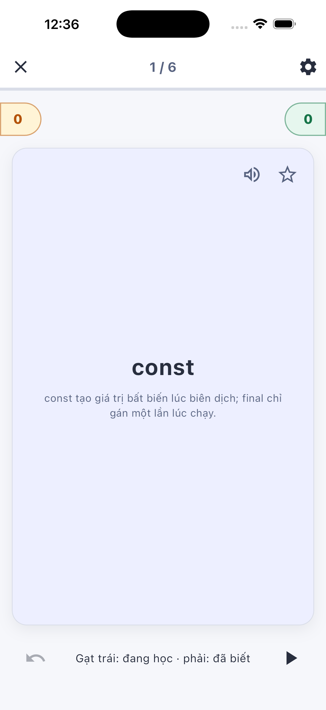
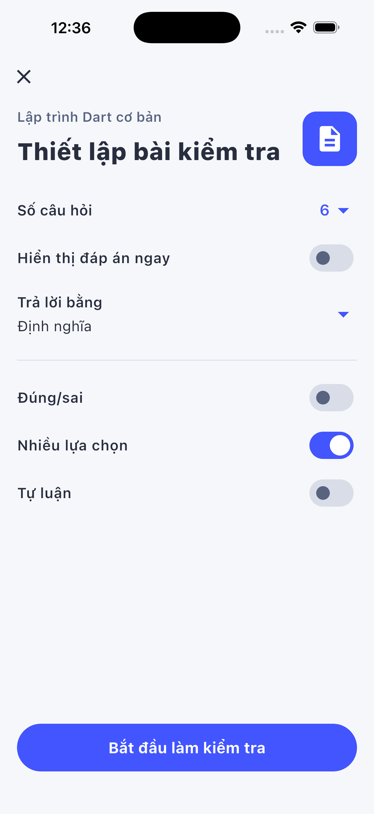
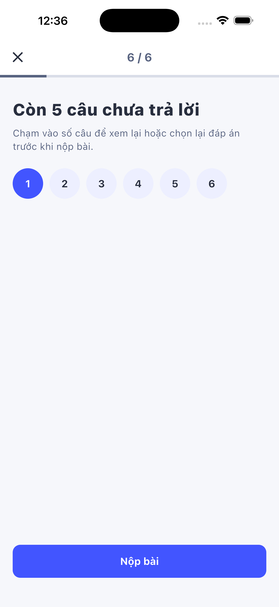
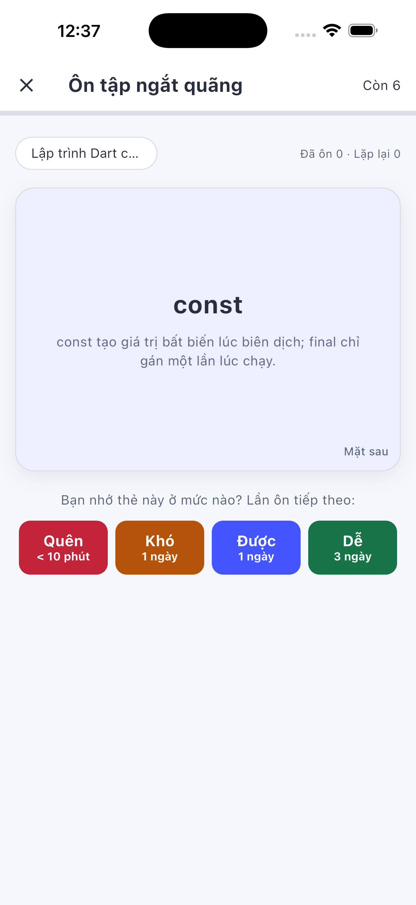
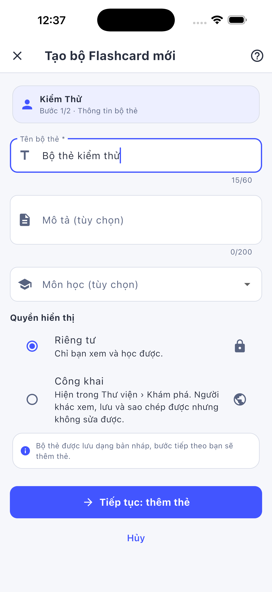
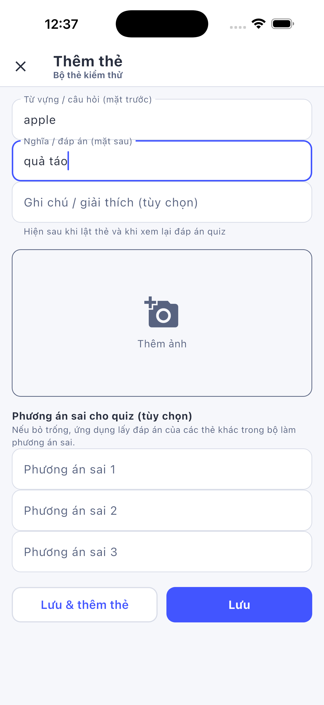
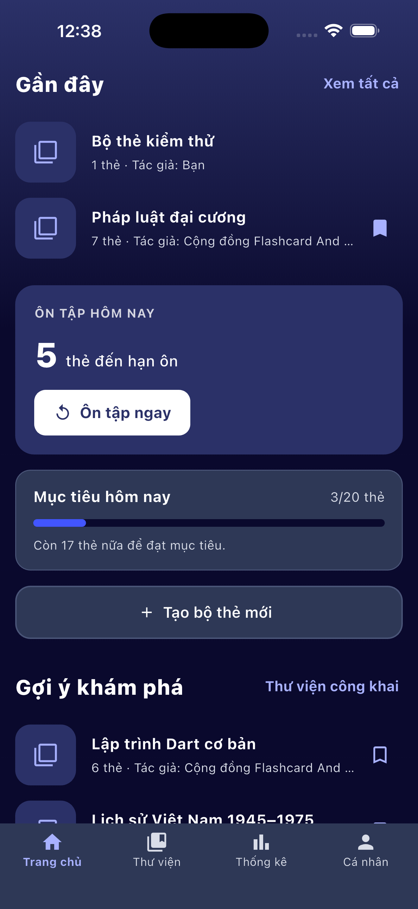
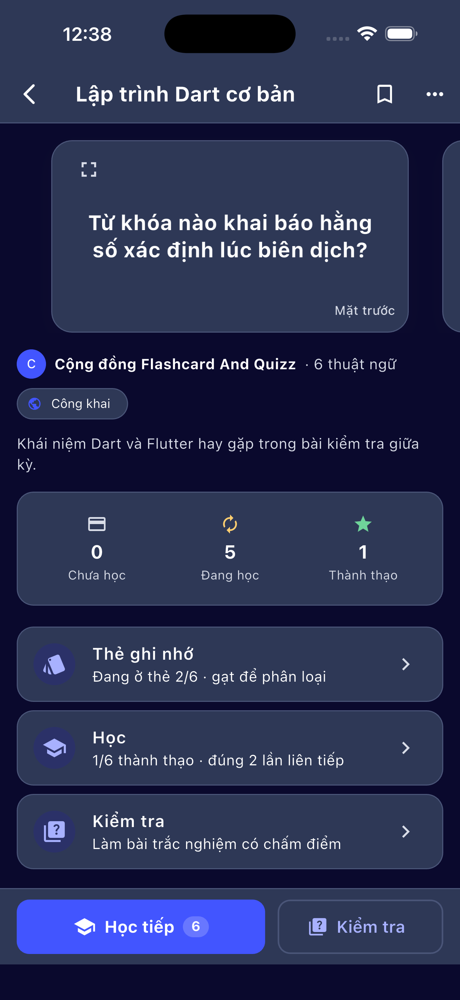

# Flashcard And Quizz – Ứng dụng học tập bằng Flashcard và Quiz

> Bài tập lớn môn **Lập trình cho thiết bị di động** – Trường Đại học Phenikaa (học kỳ 1, 2026–2027)
> Đề tài: **Xây dựng ứng dụng mobile quiz flashcard học tập**

Flashcard And Quizz giúp sinh viên tự tạo bộ thẻ ghi nhớ, học bằng lật thẻ, luyện tập theo lượt, làm bài kiểm tra trắc nghiệm và theo dõi tiến độ học. Dữ liệu được đồng bộ theo tài khoản qua Firebase và vẫn dùng được khi mất mạng. Ứng dụng chạy trên Android và iOS.

- Repository: <https://github.com/GianManhDuc-23010464/nhom_duc_thuy_tung_toan>
- Video demo: [link demo]

## Mục lục

1. [Thành viên và phân công](#1-thành-viên-và-phân-công)
2. [Chức năng](#2-chức-năng)
3. [Ảnh màn hình](#3-ảnh-màn-hình)
4. [Hướng dẫn sử dụng](#4-hướng-dẫn-sử-dụng)
5. [Công nghệ](#5-công-nghệ)
6. [Kiến trúc](#6-kiến-trúc)
7. [Mô hình dữ liệu và Firestore](#7-mô-hình-dữ-liệu-và-firestore)
8. [Thuật toán học tập](#8-thuật-toán-học-tập)
9. [Cài đặt và chạy](#9-cài-đặt-và-chạy)
10. [Xử lý sự cố](#10-xử-lý-sự-cố)
11. [Kiểm thử](#11-kiểm-thử)
12. [Hạn chế và hướng phát triển](#12-hạn-chế-và-hướng-phát-triển)
13. [Quy ước commit](#13-quy-ước-commit)

## 1. Thành viên và phân công

| Họ tên | MSSV | Phụ trách |
|---|---|---|
| Gian Mạnh Đức | 23010464 | Kết nối Firebase, xác thực, lớp dữ liệu (`data_store`, `flashcard_service`), Trang chủ, Thư viện, Chi tiết bộ thẻ |
| Nguyễn Đình Tùng | 24100188 | Lớp chung `BaseEntity`, `FirestoreRepository<T>`, `BaseScaffold`, Thống kê, `ListFlashcardSet`, test Firestore |
| Mai Thị Thủy | 23010362 | Trang cá nhân & cài đặt, sửa hồ sơ, đăng nhập / đăng ký / quên mật khẩu, nhắc học, `ListQuizAttempt` |
| Vũ Đức Toàn | 24100233 | Học thẻ ghi nhớ, học theo lượt, bài kiểm tra & kết quả, `ListFlashcard`, thư mục `logic/` |

Giảng viên hướng dẫn: Nguyễn Lệ Thu

## 2. Chức năng

**Tài khoản**
- Đăng ký, đăng nhập, đăng xuất bằng email / mật khẩu (Firebase Authentication); tự giữ phiên đăng nhập.
- Quên mật khẩu: gửi email đặt lại mật khẩu.
- Đổi tên hiển thị; tên tác giả trên các bộ thẻ được cập nhật theo.
- Thông báo lỗi bằng tiếng Việt (email đã tồn tại, sai mật khẩu, mất mạng…).

**Trang chủ**
- Học tiếp bộ thẻ gần nhất (hiện % câu hỏi đã hoàn thành), bộ thẻ gần đây, số thẻ đến hạn ôn hôm nay, mục tiêu trong ngày, gợi ý bộ thẻ công khai.

**Bộ thẻ và thẻ**
- Tạo bộ thẻ theo 2 bước (thông tin → thêm thẻ), lưu nháp cho đến khi bấm Hoàn tất.
- Sửa, xóa, sao chép bộ thẻ; đặt chế độ riêng tư hoặc công khai; phân loại theo môn học.
- Thêm / sửa / xóa / sắp xếp thẻ: mặt trước, mặt sau, ghi chú, ảnh, tối đa 3 phương án sai tự nhập.
- Gắn sao thẻ khó để học riêng.
- Màn quản lý (Cá nhân › Cài đặt): danh sách bộ thẻ, thẻ, kết quả kiểm tra với thêm / sửa / xóa có xác nhận.

**Thư viện**
- 3 tab: Của tôi / Đã lưu / Khám phá (bộ thẻ công khai của mọi người dùng).
- Tìm kiếm, lọc theo môn học, sắp xếp.

**Học tập**
- Thẻ ghi nhớ: lật thẻ, vuốt trái (Đang học) / vuốt phải (Đã biết), hoàn tác, tự động phát, đảo mặt thẻ, đọc to nội dung (Text-to-Speech); học lại các thẻ Đang học khi hết lượt.
- Học theo lượt: mỗi lượt tối đa 7 thẻ, thẻ cần đúng 2 lần liên tiếp để thành thạo, thẻ sai được hỏi lại trước; tùy chọn câu tự luận, trả lời bằng thuật ngữ, chỉ học thẻ gắn sao.
- Ôn tập ngắt quãng: thẻ đến hạn được xếp lịch ôn theo thuật toán SM-2 rút gọn (Quên / Khó / Được / Dễ).
- Lưu vị trí học dở, thoát ra vẫn học tiếp được.

**Bài kiểm tra**
- Thiết lập: số câu, hiển thị đáp án ngay, chỉ hỏi thẻ gắn sao, trả lời bằng định nghĩa / thuật ngữ / cả hai, chọn dạng câu hỏi.
- 3 dạng câu: trắc nghiệm (tối đa 4 phương án), Đúng / Sai, tự luận.
- Chọn đáp án xong tự chuyển câu; màn cuối để xem lại, chọn lại đáp án rồi nộp bài; lưu nháp bài làm dở; chống nộp hai lần.
- Kết quả: % câu đúng, số câu đúng / sai, xem lại từng câu kèm đáp án đúng và giải thích, lọc câu sai, làm lại các câu sai; câu sai đưa thẻ về trạng thái Đang học.
- Lịch sử các lần làm bài.

**Thống kê và cá nhân**
- Số thẻ theo trạng thái (Chưa học / Đang học / Thành thạo), chuỗi ngày học, mục tiêu thẻ mỗi ngày, biểu đồ hoạt động theo ngày / tuần.
- Giao diện sáng / tối / theo hệ thống.
- Nhắc học hằng ngày bằng thông báo cục bộ vào giờ đã chọn.

**Offline**
- Dữ liệu được lưu trong cache của Firestore; thao tác khi mất mạng sẽ tự đồng bộ khi có mạng lại. Kết quả bài kiểm tra chưa đồng bộ được đánh dấu "chờ đồng bộ".

## 3. Ảnh màn hình

| Trang chủ | Thư viện | Chi tiết bộ thẻ | Học thẻ |
|---|---|---|---|
|  |  |  |  |

| Bài kiểm tra | Kết quả | Thống kê | Cá nhân |
|---|---|---|---|
|  |  |  |  |

| Thẻ ghi nhớ | Thiết lập bài kiểm tra | Trước khi nộp bài | Ôn tập ngắt quãng |
|---|---|---|---|
|  |  |  |  |

| Tạo bộ thẻ | Thêm thẻ | Trang chủ (tối) | Chi tiết bộ thẻ (tối) |
|---|---|---|---|
|  |  |  |  |

## 4. Hướng dẫn sử dụng

### Bắt đầu
1. Mở app, chọn **Đăng ký ngay**, nhập tên hiển thị, email, mật khẩu (ít nhất 6 ký tự) và đồng ý điều khoản. Đăng ký xong được đăng nhập luôn.
2. Tài khoản mới chưa có dữ liệu: Trang chủ gợi ý **Tạo bộ thẻ đầu tiên** hoặc **Khám phá thư viện công khai** để lưu một bộ có sẵn.
3. Lần sau mở app sẽ tự vào Trang chủ (phiên đăng nhập được Firebase giữ lại).

### Tạo bộ thẻ
1. Bấm **+ Tạo bộ thẻ mới** (Trang chủ) hoặc **+** (Thư viện).
2. Nhập tên, mô tả, môn học, chọn Riêng tư / Công khai → **Tiếp tục: thêm thẻ**.
3. Thêm từng thẻ: mặt trước, mặt sau, ghi chú (hiện khi lật thẻ và khi xem lại bài kiểm tra), ảnh, tối đa 3 phương án sai. Phương án sai tự nhập giúp câu trắc nghiệm hay hơn; nếu bỏ trống, app lấy đáp án của các thẻ khác.
4. Bấm **Hoàn tất**. Bộ thẻ chưa hoàn tất được giữ ở dạng **Bản nháp**.

### Học bằng thẻ ghi nhớ
- Chạm vào thẻ để lật. Vuốt **phải** nếu đã biết, vuốt **trái** nếu còn đang học; thả tay khi chưa đủ xa thì thẻ bật về chỗ cũ.
- Hai ô ở mép màn hình đếm số thẻ Đang học (cam) và Đã biết (xanh).
- Nút **↶** quay lại thẻ trước; nút **▶** bật tự động phát (3 giây lật thẻ, 3 giây sau sang thẻ tiếp).
- ⚙️: hiện mặt sau trước, xáo trộn thẻ, học lại từ đầu. Biểu tượng loa đọc to nội dung, ngôi sao để gắn sao thẻ.
- Bấm **X** để thoát: vị trí và kết quả phân loại được lưu, lần sau học tiếp đúng chỗ. Hết lượt có thể **Học lại các thẻ Đang học** hoặc **Học lại toàn bộ**.

### Học theo lượt
- Mỗi câu hỏi mặt trước của thẻ, chọn đáp án đúng; app báo đúng / sai ngay và hiện đáp án đúng.
- Không chắc thì bấm **Bạn không biết?** (tính là sai, thẻ sẽ được hỏi lại).
- Sau mỗi lượt có bảng tổng kết; tiến độ (% câu hỏi đã hoàn thành) hiện ở Trang chủ.
- ⚙️: trộn thứ tự, câu hỏi tự luận, trả lời bằng thuật ngữ, chỉ học thẻ gắn sao, học lại từ đầu.

### Làm bài kiểm tra
1. Chi tiết bộ thẻ → **Kiểm tra** → chọn số câu, dạng câu hỏi, cách trả lời → **Bắt đầu làm kiểm tra**.
2. Chọn đáp án xong app tự chuyển câu. Dùng **‹** / **Bỏ qua ›** để di chuyển.
3. Sau câu cuối là màn tổng hợp: chạm số câu để xem lại hoặc chọn lại đáp án, rồi **Nộp bài**.
4. Màn kết quả có % đúng, đáp án từng câu, nút **Ôn luyện bằng chế độ Học** và **Làm lại các câu sai**.
5. Bấm **X** giữa chừng: bài được lưu nháp, Trang chủ hiện thẻ **Quiz đang làm dở** để làm tiếp hoặc hủy.

### Ôn tập
- Trang chủ hiện số thẻ đến hạn ôn → **Ôn tập ngay**. Lật thẻ rồi tự đánh giá **Quên / Khó / Được / Dễ**; app tính ngày ôn tiếp theo cho từng thẻ.

### Cá nhân
- **Chỉnh sửa hồ sơ**: đổi tên hiển thị và mục tiêu thẻ mỗi ngày.
- **Nhắc ôn tập hằng ngày**: bật lên, cho phép thông báo, chạm để chọn giờ. Lịch nhắc lưu theo tài khoản, đăng nhập trên máy khác sẽ được đặt lại.
- **Quản lý bộ thẻ / kết quả kiểm tra**, **Giao diện** (sáng / tối / theo hệ thống), **Gửi email đặt lại mật khẩu**, **Đăng xuất**.

## 5. Công nghệ

| Thành phần | Gói | Phiên bản | Dùng để |
|---|---|---|---|
| Framework | Flutter / Dart | SDK ≥ 3.9 | Giao diện đa nền tảng Android, iOS |
| Firebase | `firebase_core` | ^4.0.0 | Khởi tạo Firebase |
| Xác thực | `firebase_auth` | ^6.0.0 | Đăng ký, đăng nhập, đặt lại mật khẩu |
| Cơ sở dữ liệu | `cloud_firestore` | ^6.7.1 | Lưu bộ thẻ, tiến độ, kết quả; cache offline |
| Trạng thái | `provider` | ^6.1.1 | Cung cấp service cho các màn hình |
| Biểu đồ | `fl_chart` | ^0.68.0 | Biểu đồ hoạt động ở Thống kê |
| Thông báo | `flutter_local_notifications`, `timezone`, `flutter_timezone` | ^22.3.2, ^0.11.2, ^5.1.1 | Nhắc học hằng ngày đúng giờ theo múi giờ của máy |
| Mạng | `connectivity_plus` | ^7.3.2 | Phát hiện mất mạng, hiện banner offline |
| Ảnh | `image_picker`, `path_provider`, `path` | | Chọn ảnh, lưu vào thư mục của app |
| Khác | `uuid`, `shared_preferences` | | Sinh ID; lưu chế độ giao diện |
| Phát âm | MethodChannel `flashcard_app/speech` | | Gọi `AVSpeechSynthesizer` (iOS) và `TextToSpeech` (Android), tự chọn giọng Việt / Anh |
| Kiểm thử | `flutter_test`, `integration_test`, `fake_cloud_firestore`, `firebase_auth_mocks`, `mock_exceptions` | | Test không cần Firebase thật |

## 6. Kiến trúc

```
UI (pages, widgets)
   │  đọc / gọi qua Provider
   ▼
FlashcardService  ── nguồn dữ liệu duy nhất, ghi tuần tự, khôi phục khi ghi lỗi
   │  dùng logic thuần Dart          │  ghi / đọc qua interface
   ▼                                 ▼
logic/ (quiz, học theo lượt,     DataStore
SM-2, thống kê)                    ├─ FirestoreDataStore → FirestoreRepository<T> → Cloud Firestore
                                   └─ LocalDataStore (bộ nhớ, dùng cho test)
```

**Các tầng**
- **UI** (`pages/`, `widgets/`): chỉ hiển thị và gọi service, không truy cập Firestore trực tiếp.
- **Service** (`services/`): `FlashcardService` giữ toàn bộ dữ liệu của người dùng đang đăng nhập trong bộ nhớ; `AuthService`, `ReminderService`, `ConnectivityService` lo phần việc riêng.
- **Logic** (`logic/`): Dart thuần, không phụ thuộc Flutter hay Firebase (tạo câu hỏi, học theo lượt, SM-2, thống kê) nên test được độc lập.
- **Lưu trữ** (`DataStore`): interface ranh giới với backend. App dùng `FirestoreDataStore`; test dùng `LocalDataStore` trong bộ nhớ.

**Provider** cung cấp trong `main.dart`: `FlashcardService`, `AuthService`, `ConnectivityService`, `ReminderService`, `ThemeProvider` (sáng / tối, đăng xuất) và `TabNavigator` (chuyển 4 tab Trang chủ / Thư viện / Thống kê / Cá nhân từ bất kỳ màn hình nào).

**Luồng khởi động**
1. `main()` khởi tạo Firebase và bật cache offline của Firestore.
2. Màn khởi động chờ Firebase khôi phục phiên (`authStateChanges`), đọc hồ sơ `users/{uid}`.
3. `FlashcardService.loadForUser` tải bộ thẻ (của mình + công khai), tiến độ, kết quả kiểm tra, trạng thái học dở; đặt lại lịch nhắc học theo cài đặt của tài khoản.
4. Nếu phiên hết hạn hoặc bị đăng xuất ở nơi khác, app tự quay về màn Đăng nhập.

**Luồng ghi dữ liệu** (ví dụ sửa một thẻ)
1. Màn hình gọi `service.updateCard(...)`.
2. `_commit` chụp lại trạng thái hiện tại, sửa dữ liệu trong bộ nhớ và cập nhật giao diện ngay.
3. Ghi đúng document liên quan: `decks/{deckId}/cards/{cardId}` và thời điểm cập nhật ở `decks/{deckId}`. Các lần ghi được xếp hàng tuần tự để không ghi chồng.
4. Nếu ghi lỗi (ví dụ bị từ chối quyền), dữ liệu trong bộ nhớ được khôi phục và màn hình báo lỗi kèm nút **Thử lại**.

**Offline**: Firestore chỉ báo ghi xong khi máy chủ xác nhận. Khi mất mạng (hoặc chờ quá 8 giây), `FirestoreDataStore` coi như đã ghi vào cache cục bộ và để Firestore tự đồng bộ sau; trạng thái "chờ đồng bộ" của kết quả kiểm tra lấy từ `metadata.hasPendingWrites`, khi đồng bộ xong app hiện thông báo.

**Cấu trúc thư mục**

```
lib/
├── main.dart                  # Khởi tạo Firebase, Provider, luồng đăng nhập, bottom navigation
├── firebase_options.dart      # Sinh bởi flutterfire configure
├── models/                    # BaseEntity, FlashcardSet, Flashcard, CardProgress, Quiz, User, UserData
├── logic/                     # quiz_engine, learn_engine, progress_lifecycle (SM-2), stats_calculator
├── services/                  # auth_service, data_store, firestore_repository, flashcard_service,
│                              # connectivity_service, reminder_service, speech_service, seed_data
├── pages/                     # Các màn hình (+ ListFlashcardSet, ListFlashcard, ListQuizAttempt)
├── widgets/                   # base_scaffold, flip_card, set_card, gradient_learn_button, common
├── theme/                     # app_theme (màu sáng / tối)
├── utils/                     # date_utils, validators, nav
└── tools/seed.dart            # Đẩy bộ thẻ công khai mẫu lên Firestore (chạy một lần)
test/                          # Unit test và widget test
integration_test/              # Kiểm thử luồng chính trên thiết bị
docs/screenshots/              # Ảnh màn hình
firestore.rules                # Quy tắc bảo mật Firestore
```

**Lớp dùng chung**
- `BaseEntity`: lớp trừu tượng gồm `id`, `name`, `description`, `createdAt`, `updatedAt`, `toMap()`; `FlashcardSet`, `Flashcard`, `QuizAttempt` kế thừa.
- `FirestoreRepository<T extends BaseEntity>`: CRUD tổng quát `getAll`, `getById`, `add`, `update`, `delete`, `watchAll`.
- `BaseScaffold`: khung màn hình thống nhất AppBar, màu, font cho các trang chính.

## 7. Mô hình dữ liệu và Firestore

| Model | Ý nghĩa | Trường chính |
|---|---|---|
| `FlashcardSet` | Bộ thẻ | `id`, `userId` (chủ), `ownerName`, `title`, `description`, `subject`, `visibility` (`private` / `public`), `status` (`draft` / `ready`), `cards` |
| `Flashcard` | Thẻ | `id` (không đổi khi sửa nội dung), `term`, `meaning`, `note`, `imagePath`, `wrongOptions` |
| `CardProgress` | Tiến độ một thẻ của một người | `interval` (ngày), `ease`, `reps`, `due`, `known` |
| `QuizAttempt` | Một lần làm bài | `deckId`, `deckTitle`, `takenAt`, `durationSeconds`, `items` (câu hỏi + đáp án đã chọn) |
| `QuizDraft` | Bài đang làm dở | `questions`, `answers`, `typed`, `currentIndex`, `instantFeedback` |
| `User` | Hồ sơ | `id` (uid), `username`, `email`, `createdAt` |
| `UserData` | Dữ liệu học của một người | tiến độ, bộ đã lưu, thẻ gắn sao, lịch sử kiểm tra, `activity` (số lượt học theo ngày), mục tiêu (mặc định 20 thẻ), nhắc học (mặc định 20:00), trạng thái học dở |

```
decks/{deckId}                       # Bộ thẻ: userId, ownerName, title, description, subject,
│                                    #         visibility, status, createdAt, updatedAt
└── cards/{cardId}                   # Thẻ: term, meaning, note, wrongOptions, imagePath, order, createdAt, updatedAt

users/{uid}                          # Hồ sơ + cài đặt: username, email, createdAt, dailyGoal, remindEnabled,
│                                    #   remindTime, savedDeckIds, starredCardIds, lastDeckId, sessions, activity
├── progress/{cardId}                # Tiến độ thẻ: interval, ease, reps, due, known
├── quizAttempts/{attemptId}         # Kết quả bài kiểm tra: deckId, deckTitle, takenAt, durationSeconds, items
└── state/learn                      # Học dở: positions, learnScores, learnRounds, flashSort, quizDraft
```

- **Tách nội dung và tiến độ:** bộ thẻ nằm ở `decks`, tiến độ nằm ở `users/{uid}/progress`, nên cùng một bộ thẻ công khai mỗi người có tiến độ riêng.
- **Thứ tự thẻ** lưu bằng trường `order`; đổi chỗ 2 thẻ chỉ ghi lại 2 document đó.
- **Xóa bộ thẻ** dùng batch xóa cả subcollection `cards` và tiến độ các thẻ; lịch sử kiểm tra vẫn giữ (hiển thị bằng `deckTitle` đã lưu).
- **Khám phá** truy vấn `decks` với `visibility == 'public'`, loại bộ thẻ của chính người dùng.
- Ngày giờ lưu dạng `Timestamp`; mỗi model có `toFirestore()` / `fromFirestore()`.

**Quy tắc bảo mật** (`firestore.rules`)
- `users/{uid}` và các subcollection: chỉ chính chủ được đọc / ghi.
- `decks/{deckId}` và `cards`: đọc được nếu là chủ hoặc bộ thẻ công khai; chỉ chủ được tạo / sửa / xóa và không được đổi chủ sở hữu.

## 8. Thuật toán học tập

**Trạng thái thẻ:** Chưa học → Đang học → Thành thạo. Lật thẻ ghi nhớ chỉ đưa thẻ sang Đang học; thẻ thành thạo khi trả lời đúng trong Học hoặc Ôn tập.

**Học theo lượt** (`logic/learn_engine.dart`)
- Mỗi lượt hỏi tối đa 7 thẻ chưa đạt; thẻ cần đúng **2 lần liên tiếp** để thành thạo, trả lời sai đặt điểm thẻ về 0.
- Thẻ sai ở lượt trước được hỏi đầu tiên ở lượt sau; khi bật câu tự luận, thẻ đã đúng 1 lần được hỏi bằng cách gõ đáp án.
- % hoàn thành = tổng điểm các thẻ (mỗi thẻ tối đa 2) / (số thẻ × 2). Điểm lưu sau mỗi câu nên thoát ra vẫn làm tiếp được.

**Ôn tập ngắt quãng – SM-2 rút gọn** (`logic/progress_lifecycle.dart`)

| Đánh giá | Khoảng cách ôn mới | Hệ số dễ (ease, tối thiểu 1,3) |
|---|---|---|
| Quên | ôn lại trong hôm nay | −0,2 |
| Khó | khoảng cũ × 1,2 (ít nhất 1 ngày) | −0,15 |
| Được | 1 ngày → 3 ngày → khoảng cũ × ease | giữ nguyên |
| Dễ | 3 ngày, sau đó khoảng cũ × ease × 1,3 | +0,15 |

**Bài kiểm tra** (`logic/quiz_engine.dart`)
- Số lựa chọn mỗi câu tối đa 4, giảm xuống nếu bộ thẻ không đủ dữ liệu; phương án sai lấy từ phương án tự nhập của thẻ trước, sau đó từ đáp án của các thẻ khác.
- Các dạng câu được chia đều theo những dạng đã chọn rồi trộn ngẫu nhiên.
- Câu Đúng / Sai đưa ra ngẫu nhiên đáp án đúng hoặc một phương án sai để người làm xét.
- Câu tự luận chấm không phân biệt hoa thường, khoảng trắng thừa và dấu câu ở cuối.
- Câu sai hoặc bỏ trống đưa thẻ về Đang học và đến hạn ôn ngay hôm nay.

**Thống kê** (`logic/stats_calculator.dart`): chuỗi ngày học là số ngày liên tiếp tính đến hôm nay có ít nhất một lượt học; biểu đồ lấy số lượt học của 7 ngày và 4 tuần gần nhất.

## 9. Cài đặt và chạy

**Yêu cầu:** Flutter SDK ≥ 3.9, Xcode (iOS) hoặc Android Studio (Android), Node.js để cài Firebase CLI.

```bash
git clone https://github.com/GianManhDuc-23010464/nhom_duc_thuy_tung_toan.git
cd nhom_duc_thuy_tung_toan
flutter pub get
flutter run
```

Repository đã có cấu hình Firebase của nhóm (`lib/firebase_options.dart`, `android/app/google-services.json`, `ios/Runner/GoogleService-Info.plist`), nên chạy được ngay.

**Dùng project Firebase riêng**

```bash
npm install -g firebase-tools
dart pub global activate flutterfire_cli
firebase login
flutterfire configure            # sinh lại 3 file cấu hình ở trên
```

Trên Firebase Console:
1. Authentication → Sign-in method → bật **Email/Password**.
2. Firestore Database → tạo database ở chế độ test.

Sau đó (theo đúng thứ tự):

```bash
flutter run -t lib/tools/seed.dart          # 1. Đẩy 7 bộ thẻ công khai mẫu (khi Firestore còn ở chế độ test)
firebase deploy --only firestore:rules      # 2. Bật quy tắc bảo mật
```

**Cấu hình nền tảng đã có sẵn trong repo**
- Android: bật core library desugaring (`android/app/build.gradle.kts`); `AndroidManifest.xml` khai báo quyền `POST_NOTIFICATIONS`, `RECEIVE_BOOT_COMPLETED` và receiver của `flutter_local_notifications` để nhắc học vẫn chạy sau khi khởi động lại máy.
- iOS: `AppDelegate.swift` gán delegate thông báo để hiện nhắc học cả khi app đang mở, và cài kênh phát âm bằng `AVSpeechSynthesizer`.

## 10. Xử lý sự cố

| Hiện tượng | Nguyên nhân / cách xử lý |
|---|---|
| Đăng ký báo "Đăng nhập bằng email chưa được bật cho ứng dụng" | Chưa bật Email/Password trong Firebase Authentication. |
| Tab Khám phá trống | Chưa chạy `lib/tools/seed.dart`, hoặc chạy sau khi đã deploy rules (rules chặn tạo bộ thẻ của người khác). |
| Công cụ seed báo `permission-denied` | Firestore không còn ở chế độ test; tạm mở quyền ghi hoặc thêm bộ thẻ mẫu qua Console. |
| Màn hình "Không tải được dữ liệu" | Mất mạng ở lần đăng nhập đầu tiên trên máy (chưa có cache); bấm Thử lại khi có mạng. |
| Không nhận được nhắc học | Chưa cho phép thông báo: bật lại trong Cài đặt của máy rồi tắt / bật lại công tắc Nhắc ôn tập. Android có thể nhắc lệch vài phút để tiết kiệm pin. |
| Thẻ hiện "Ảnh không có trên thiết bị này" | Ảnh thẻ chỉ lưu trên máy đã thêm ảnh (xem mục 12). |
| Không nhận được email đặt lại mật khẩu | Kiểm tra thư mục Spam; email chưa đăng ký sẽ không nhận được thư. |

## 11. Kiểm thử

```bash
flutter analyze                      # Phân tích tĩnh
flutter test                         # Unit test + widget test (126 test)
flutter test integration_test        # Kiểm thử luồng chính, cần mở simulator / thiết bị
```

Tất cả test dùng Firebase giả lập (`fake_cloud_firestore`, `firebase_auth_mocks`), không gọi Firebase thật.

| File | Nội dung |
|---|---|
| `logic_test.dart` | Vòng đời tiến độ thẻ, SM-2, tạo câu hỏi quiz, học theo lượt, thống kê |
| `service_test.dart` | Tạo / sửa / xóa bộ thẻ, nộp quiz, khôi phục khi ghi lỗi, tách dữ liệu theo người dùng |
| `auth_service_test.dart` | Đăng ký, trùng email, sai mật khẩu, quên mật khẩu, đổi tên, thông báo lỗi |
| `firestore_repository_test.dart` | CRUD và `watchAll` của `FirestoreRepository<T>` |
| `firestore_model_test.dart` | Chuyển model sang Firestore và đọc lại |
| `firestore_data_store_test.dart` | Ghi / đọc đúng document trên Firestore giả lập |
| `reminder_service_test.dart` | Đặt lịch nhắc học lặp hằng ngày, đổi giờ, hủy |
| `widget_test.dart`, `responsive_test.dart` | Giao diện các màn hình chính, nhiều kích thước màn hình |
| `integration_test/app_flow_test.dart` | 10 luồng chính: đăng ký, thư viện, chi tiết bộ thẻ, thẻ ghi nhớ, học theo lượt, kiểm tra, ôn tập, tạo bộ thẻ, thống kê / cá nhân, giao diện tối |

## 12. Hạn chế và hướng phát triển

- **Ảnh thẻ chưa đồng bộ:** ảnh lưu trong thư mục của app trên máy đã thêm ảnh; mở trên máy khác sẽ hiện ảnh thay thế. Hướng phát triển: lưu ảnh lên Firebase Storage.
- **Link chia sẻ chưa mở được app:** link `flashcardandquizz.app/d/…` mới là định dạng mẫu, cần App Links / Universal Links và một trang web để hoạt động.
- **Khám phá tải toàn bộ bộ thẻ công khai** khi đăng nhập; khi dữ liệu lớn cần phân trang.
- **Chưa đăng nhập bằng Google / Apple**, chưa xác minh email.

## 13. Quy ước commit

- Mỗi thành viên commit phần mình phụ trách bằng tài khoản GitHub của mình.
- Mỗi commit một mục đích, message tiếng Việt theo dạng `loại(phạm vi): mô tả`, ví dụ:
  - `feat(quiz): thêm câu hỏi Đúng/Sai`
  - `fix(stats): sửa số thẻ đến hạn`
  - `test(auth): test đăng nhập sai mật khẩu`
- Loại: `feat` (chức năng), `fix` (sửa lỗi), `refactor`, `test`, `docs`, `chore` (cấu hình, dọn dẹp).
- Chạy `flutter analyze` và `flutter test` trước khi push.
