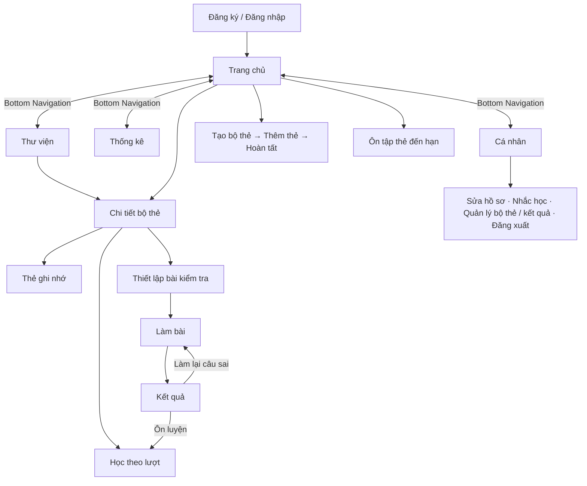

# Flashcard And Quizz – Ứng dụng học tập bằng Flashcard và Quiz

> Bài tập lớn môn **Lập trình cho thiết bị di động** – Trường Đại học Phenikaa (học kỳ 1, 2026–2027)
> Đề tài: **Xây dựng ứng dụng mobile quiz flashcard học tập**

Flashcard And Quizz giúp sinh viên tự tạo bộ thẻ ghi nhớ, học bằng lật thẻ, luyện tập theo lượt, làm bài kiểm tra trắc nghiệm và theo dõi tiến độ học. Dữ liệu được đồng bộ theo tài khoản qua Firebase và vẫn dùng được khi mất mạng. Ứng dụng chạy trên Android và iOS.

- Repository: <https://github.com/GianManhDuc-23010464/nhom_duc_thuy_tung_toan>
- Video demo: [link demo]

## Mục lục

1. [Thành viên và phân công](#1-thành-viên-và-phân-công)
2. [Chức năng](#2-chức-năng)
3. [Ảnh màn hình và luồng sử dụng](#3-ảnh-màn-hình-và-luồng-sử-dụng)
4. [Số lượng màn hình và Bottom Navigation Bar](#4-số-lượng-màn-hình-và-bottom-navigation-bar)
5. [Công nghệ](#5-công-nghệ)
6. [Kiến trúc và cấu trúc thư mục](#6-kiến-trúc-và-cấu-trúc-thư-mục)
7. [Cơ sở dữ liệu Firestore](#7-cơ-sở-dữ-liệu-firestore)
8. [Thuật toán học tập](#8-thuật-toán-học-tập)
9. [Cài đặt và chạy](#9-cài-đặt-và-chạy)
10. [Kiểm thử](#10-kiểm-thử)
11. [Quy trình commit](#11-quy-trình-commit)
12. [Bảo mật và dữ liệu](#12-bảo-mật-và-dữ-liệu)

## 1. Thành viên và phân công

Giảng viên hướng dẫn: Nguyễn Lệ Thu

| Họ tên | MSSV | Phụ trách |
|---|---|---|
| Gian Mạnh Đức | 23010464 | Kết nối Firebase, xác thực, lớp dữ liệu (`data_store`, `flashcard_service`), Trang chủ, Thư viện, Chi tiết bộ thẻ |
| Nguyễn Đình Tùng | 24100188 | Lớp chung `BaseEntity`, `FirestoreRepository<T>`, `BaseScaffold`, Thống kê, `ListFlashcardSet`, test Firestore |
| Mai Thị Thủy | 23010362 | Trang cá nhân & cài đặt, sửa hồ sơ, đăng nhập / đăng ký / quên mật khẩu, `ListQuizAttempt` |
| Vũ Đức Toàn | 24100233 | Học thẻ ghi nhớ, học theo lượt, bài kiểm tra & kết quả, `ListFlashcard`, thư mục `logic/` |

### Gian Mạnh Đức
- Kết nối Firebase (`firebase_options.dart`, `main.dart`), cache offline của Firestore.
- Lớp dữ liệu: `services/data_store.dart` (`FirestoreDataStore`, `LocalDataStore`), `services/flashcard_service.dart`, `services/seed_data.dart`, `firestore.rules`.
- Màn hình: Trang chủ (`home_page.dart`), Thư viện (`library_page.dart`), Chi tiết bộ thẻ (`set_detail_page.dart`), tạo / sửa bộ thẻ và thẻ (`add_set_page.dart`, `add_edit_flashcard_page.dart`, `deck_cards_page.dart`).

### Nguyễn Đình Tùng
- Lớp dùng chung: `models/base_entity.dart`, `services/firestore_repository.dart`, `widgets/base_scaffold.dart`.
- Màn hình: Thống kê (`stats_page.dart`, biểu đồ `fl_chart`), quản lý bộ thẻ (`ListFlashcardSet.dart`).
- Kiểm thử: `firestore_repository_test.dart`, `firestore_model_test.dart`, `firestore_data_store_test.dart`.

### Mai Thị Thủy
- Xác thực: `services/auth_service.dart` (thông báo lỗi tiếng Việt), `login_page.dart`, `register_page.dart`, `forgot_password_page.dart`.
- Màn hình: Cá nhân & cài đặt (`profile_page.dart`), sửa hồ sơ (`edit_profile_page.dart`), nhắc học hằng ngày (`services/reminder_service.dart`), quản lý kết quả kiểm tra (`ListQuizAttempt.dart`).
- Kiểm thử: `auth_service_test.dart`, `reminder_service_test.dart`.

### Vũ Đức Toàn
- Logic thuần Dart: `logic/quiz_engine.dart`, `logic/learn_engine.dart`, `logic/progress_lifecycle.dart`, `logic/stats_calculator.dart`.
- Màn hình: Thẻ ghi nhớ (`learn_page.dart`, `widgets/flip_card.dart`), Học theo lượt (`learn_rounds_page.dart`), Ôn tập (`review_page.dart`), Bài kiểm tra (`quiz_setup_page.dart`, `test_page.dart`, `quiz_result_page.dart`), quản lý thẻ (`ListFlashcard.dart`).
- Kiểm thử: `logic_test.dart`.

## 2. Chức năng

**Tài khoản**
- Đăng ký, đăng nhập, đăng xuất bằng email / mật khẩu (Firebase Authentication); tự giữ phiên đăng nhập.
- Quên mật khẩu: gửi email đặt lại mật khẩu.
- Đổi tên hiển thị; tên tác giả trên các bộ thẻ được cập nhật theo.
- Thông báo lỗi bằng tiếng Việt (email đã tồn tại, sai mật khẩu, mất mạng…).

**Trang chủ**
- Học tiếp bộ thẻ gần nhất (hiện % câu hỏi đã hoàn thành), bộ thẻ gần đây, số thẻ đến hạn ôn hôm nay, mục tiêu trong ngày, gợi ý bộ thẻ công khai.

**Bộ thẻ và thẻ**
- Tạo bộ thẻ theo 2 bước (thông tin → thêm thẻ), lưu nháp cho đến khi bấm Hoàn tất.
- Sửa, xóa, sao chép bộ thẻ; đặt chế độ riêng tư hoặc công khai; phân loại theo môn học.
- Thêm / sửa / xóa / sắp xếp thẻ: mặt trước, mặt sau, ghi chú, ảnh, tối đa 3 phương án sai tự nhập.
- Gắn sao thẻ khó để học riêng.
- Màn quản lý (Cá nhân › Cài đặt): danh sách bộ thẻ, thẻ, kết quả kiểm tra với thêm / sửa / xóa có xác nhận.

**Thư viện**
- 3 tab: Của tôi / Đã lưu / Khám phá (bộ thẻ công khai của mọi người dùng).
- Tìm kiếm và lọc theo môn học.

**Học tập**
- Thẻ ghi nhớ: lật thẻ, vuốt trái (Đang học) / vuốt phải (Đã biết), hoàn tác, tự động phát, đảo mặt thẻ, đọc to nội dung (Text-to-Speech); học lại các thẻ Đang học khi hết lượt.
- Học theo lượt: mỗi lượt tối đa 7 thẻ, thẻ cần đúng 2 lần liên tiếp để thành thạo, thẻ sai được hỏi lại trước; tùy chọn câu tự luận, trả lời bằng thuật ngữ, chỉ học thẻ gắn sao.
- Ôn tập ngắt quãng: thẻ đến hạn được xếp lịch ôn theo thuật toán SM-2 rút gọn (Quên / Khó / Được / Dễ).
- Lưu vị trí học dở, thoát ra vẫn học tiếp được.

**Bài kiểm tra**
- Thiết lập: số câu, hiển thị đáp án ngay, chỉ hỏi thẻ gắn sao, trả lời bằng định nghĩa / thuật ngữ / cả hai, chọn dạng câu hỏi.
- 3 dạng câu: trắc nghiệm (tối đa 4 phương án), Đúng / Sai, tự luận.
- Chọn đáp án xong tự chuyển câu; màn cuối để xem lại, chọn lại đáp án rồi nộp bài; lưu nháp bài làm dở; chống nộp hai lần.
- Kết quả: % câu đúng, số câu đúng / sai, xem lại từng câu kèm đáp án đúng và giải thích, lọc câu sai, làm lại các câu sai; câu sai đưa thẻ về trạng thái Đang học.
- Lịch sử các lần làm bài.

**Thống kê và cá nhân**
- Số thẻ theo trạng thái (Chưa học / Đang học / Thành thạo), chuỗi ngày học, mục tiêu thẻ mỗi ngày, biểu đồ hoạt động.
- Giao diện sáng / tối / theo hệ thống.
- Nhắc học hằng ngày bằng thông báo cục bộ vào giờ đã chọn (xin quyền thông báo; hủy khi tắt hoặc đăng xuất).

**Offline**
- Dữ liệu được lưu trong cache của Firestore; thao tác khi mất mạng sẽ tự đồng bộ khi có mạng lại. Kết quả bài kiểm tra chưa đồng bộ được đánh dấu "chờ đồng bộ".

## 3. Ảnh màn hình và luồng sử dụng

Ảnh chụp trực tiếp từ ứng dụng chạy trên iOS Simulator (iPhone 17 Pro Max).

| Trang chủ | Thư viện | Chi tiết bộ thẻ | Thẻ ghi nhớ |
|---|---|---|---|
|  |  |  |  |

| Bài kiểm tra | Kết quả | Thống kê | Cá nhân |
|---|---|---|---|
|  |  |  |  |

| Màn hình | Nội dung và thao tác chính |
|---|---|
| Trang chủ | Tìm kiếm, chuỗi ngày học, thẻ Học tiếp (% hoàn thành), bộ thẻ gần đây, số thẻ đến hạn ôn, mục tiêu hôm nay, tạo bộ thẻ, gợi ý khám phá. |
| Thư viện | 3 tab Của tôi / Đã lưu / Khám phá, tìm kiếm, lọc theo môn, sắp xếp, lưu bộ thẻ công khai. |
| Chi tiết bộ thẻ | Xem trước thẻ, tác giả, số thẻ theo trạng thái, 3 chế độ Thẻ ghi nhớ / Học / Kiểm tra, danh sách thuật ngữ, sửa / sao chép / chia sẻ / xóa. |
| Thẻ ghi nhớ | Lật thẻ, vuốt trái / phải để phân loại, bộ đếm Đang học / Đã biết, gắn sao, phát âm, hoàn tác, tự động phát. |
| Bài kiểm tra | Câu hỏi và các lựa chọn, chọn xong tự chuyển câu, quay lại / bỏ qua, màn nộp bài. |
| Kết quả | % đúng, số câu đúng / sai, bước tiếp theo (ôn bằng chế độ Học, làm bài mới, làm lại câu sai), đáp án từng câu. |
| Thống kê | Lượt học thẻ, phiên học, số bài kiểm tra, điểm trung bình, tiến độ hôm nay, biểu đồ theo ngày / tuần. |
| Cá nhân | Hồ sơ, mục tiêu hằng ngày, lịch sử kiểm tra, quản lý bộ thẻ / kết quả, giao diện, nhắc học, đổi mật khẩu, đăng xuất. |

### Luồng sử dụng



## 4. Số lượng màn hình và Bottom Navigation Bar

Ứng dụng có **25 màn hình** trong `lib/pages/`:

| Nhóm | Màn hình |
|---|---|
| Xác thực | `LoginPage`, `RegisterPage`, `ForgotPasswordPage` |
| 4 tab chính | `HomePage`, `LibraryPage`, `StatsPage`, `ProfilePage` |
| Bộ thẻ | `SetDetailPage`, `AddSetPage`, `AddEditFlashcardPage`, `DeckCardsPage` |
| Học tập | `LearnPage` (Thẻ ghi nhớ), `StudySummaryPage`, `LearnRoundsPage` (Học), `ReviewPage`, `ReviewSummaryPage` (Ôn tập) |
| Bài kiểm tra | `QuizSetupPage`, `TestPage`, `QuizResultPage`, `QuizHistoryPage`, `AnswerReviewPage` |
| Cá nhân | `EditProfilePage` |
| Quản lý (CRUD) | `ListFlashcardSet`, `ListFlashcard`, `ListQuizAttempt` |

**Bottom Navigation Bar** gồm 4 tab thường dùng nhất: Trang chủ, Thư viện, Thống kê, Cá nhân. Các màn học tập và kiểm tra không nằm trên thanh điều hướng mà mở theo luồng:

```text
Trang chủ / Thư viện → Chi tiết bộ thẻ → Thẻ ghi nhớ / Học / Kiểm tra
```

Code trong [`lib/main.dart`](lib/main.dart): 4 tab được giữ trạng thái bằng `IndexedStack`, chuyển tab qua `TabNavigator` (Provider) để các màn hình khác cũng mở được tab, ví dụ nút "Xem tất cả" ở Trang chủ mở Thư viện.

```dart
final List<Widget> _pages = const [
  HomePage(),
  LibraryPage(),
  StatsPage(),
  ProfilePage(),
];

Widget _buildMainApp(bool isDark) {
  return Consumer<TabNavigator>(
    builder: (context, tabs, _) => Scaffold(
      body: IndexedStack(index: tabs.index, children: _pages),
      bottomNavigationBar: BottomNavigationBar(
        currentIndex: tabs.index,
        onTap: tabs.go,
        items: const [
          BottomNavigationBarItem(icon: Icon(Icons.home), label: 'Trang chủ'),
          BottomNavigationBarItem(icon: Icon(Icons.collections_bookmark), label: 'Thư viện'),
          BottomNavigationBarItem(icon: Icon(Icons.bar_chart), label: 'Thống kê'),
          BottomNavigationBarItem(icon: Icon(Icons.person), label: 'Cá nhân'),
        ],
      ),
    ),
  );
}
```

## 5. Công nghệ

| Thành phần | Sử dụng |
|---|---|
| Ngôn ngữ / framework | Dart, Flutter (SDK ≥ 3.9) |
| Xác thực | Firebase Authentication (email / mật khẩu) |
| Cơ sở dữ liệu | Cloud Firestore (có offline persistence) |
| Quản lý trạng thái | Provider (`ChangeNotifier`) |
| Biểu đồ | fl_chart |
| Thông báo | flutter_local_notifications, timezone, flutter_timezone (nhắc học hằng ngày) |
| Khác | image_picker, connectivity_plus, shared_preferences (lưu chế độ giao diện), Text-to-Speech qua MethodChannel native |
| Kiểm thử | flutter_test, integration_test, fake_cloud_firestore, firebase_auth_mocks |

## 6. Kiến trúc và cấu trúc thư mục

```
UI (pages, widgets)
   │  đọc / gọi qua Provider
   ▼
FlashcardService  ── nguồn dữ liệu duy nhất, ghi tuần tự, khôi phục khi ghi lỗi
   │  dùng logic thuần Dart          │  ghi / đọc qua interface
   ▼                                 ▼
logic/ (quiz, học theo lượt,     DataStore
SM-2, thống kê)                    ├─ FirestoreDataStore → FirestoreRepository<T> → Cloud Firestore
                                   └─ LocalDataStore (bộ nhớ, dùng cho test)
```

- **Một nguồn dữ liệu:** mọi màn hình đọc từ `FlashcardService`, nên số liệu ở Trang chủ, Chi tiết bộ thẻ và Thống kê luôn khớp nhau.
- **Ghi an toàn:** mỗi thao tác cập nhật giao diện ngay rồi ghi xuống Firestore; nếu ghi lỗi thì khôi phục trạng thái trước đó và báo lỗi kèm nút thử lại.
- **Logic tách khỏi giao diện:** thư mục `logic/` là Dart thuần, không phụ thuộc Flutter hay Firebase nên kiểm thử được độc lập.

```
lib/
├── main.dart                  # Khởi tạo Firebase, Provider, luồng đăng nhập, bottom navigation
├── firebase_options.dart      # Sinh bởi flutterfire configure
├── models/                    # BaseEntity, FlashcardSet, Flashcard, CardProgress, Quiz, User, UserData
├── logic/                     # quiz_engine, learn_engine, progress_lifecycle (SM-2), stats_calculator
├── services/                  # auth_service, data_store, firestore_repository, flashcard_service,
│                              # connectivity_service, reminder_service, speech_service, seed_data
├── pages/                     # 25 màn hình (xem mục 4)
├── widgets/                   # base_scaffold, flip_card, set_card, gradient_learn_button, common
├── theme/                     # app_theme (màu sáng / tối)
├── utils/                     # date_utils, validators, nav
└── tools/seed.dart            # Đẩy bộ thẻ công khai mẫu lên Firestore (chạy một lần)
test/                          # Unit test và widget test
integration_test/              # Kiểm thử luồng chính trên thiết bị
docs/screenshots/              # Ảnh màn hình dùng trong README
firestore.rules                # Quy tắc bảo mật Firestore
```

**Lớp dùng chung**
- `BaseEntity`: lớp trừu tượng gồm `id`, `name`, `description`, `createdAt`, `updatedAt`, `toMap()`; `FlashcardSet`, `Flashcard`, `QuizAttempt` kế thừa.
- `FirestoreRepository<T extends BaseEntity>`: CRUD tổng quát `getAll`, `getById`, `add`, `update`, `delete`, `watchAll`.
- `BaseScaffold`: khung màn hình thống nhất AppBar, màu, font cho các trang chính.

## 7. Cơ sở dữ liệu Firestore

```
decks/{deckId}                       # Bộ thẻ: userId, ownerName, title, description, subject,
│                                    #         visibility (private | public), status (draft | ready), createdAt, updatedAt
└── cards/{cardId}                   # Thẻ: term, meaning, note, wrongOptions, imagePath, order, createdAt, updatedAt

users/{uid}                          # Hồ sơ + cài đặt: username, email, createdAt, dailyGoal, remindEnabled,
│                                    #   remindTime, savedDeckIds, starredCardIds, lastDeckId, sessions, activity
├── progress/{cardId}                # Tiến độ thẻ: interval, ease, reps, due, known
├── quizAttempts/{attemptId}         # Kết quả bài kiểm tra: deckId, deckTitle, takenAt, durationSeconds, items
└── state/learn                      # Học dở: positions, learnScores, learnRounds, flashSort, quizDraft
```

- Nội dung bộ thẻ (`decks`) tách khỏi tiến độ học (`users/{uid}/progress`): cùng một bộ thẻ công khai, mỗi người dùng có tiến độ riêng.
- Mỗi model có `toFirestore()` / `fromFirestore()`, ngày giờ lưu dạng `Timestamp`.
- Mỗi thao tác chỉ ghi đúng document liên quan (sửa 1 thẻ chỉ ghi `decks/{id}/cards/{cardId}`); xóa bộ thẻ dùng batch để xóa cả subcollection `cards`. Lịch sử kiểm tra vẫn giữ khi bộ thẻ bị xóa.
- Tab Khám phá truy vấn `decks` với `visibility == 'public'` và loại bộ thẻ của chính người dùng.

## 8. Thuật toán học tập

**Trạng thái thẻ:** Chưa học → Đang học → Thành thạo. Lật thẻ không được tính là đã nhớ; thẻ chỉ thành thạo khi trả lời đúng trong Học hoặc Ôn tập.

**Học theo lượt** (`logic/learn_engine.dart`)
- Mỗi lượt hỏi tối đa 7 thẻ chưa đạt; thẻ cần đúng **2 lần liên tiếp** để thành thạo, trả lời sai đặt điểm thẻ về 0.
- Thẻ sai ở lượt trước được hỏi đầu tiên ở lượt sau; khi bật câu tự luận, thẻ đã đúng 1 lần được hỏi bằng cách gõ đáp án.
- Điểm từng thẻ được lưu sau mỗi câu, thoát ra rồi mở lại sẽ làm tiếp.

**Ôn tập ngắt quãng – SM-2 rút gọn** (`logic/progress_lifecycle.dart`)

| Đánh giá | Khoảng cách ôn mới | Hệ số dễ (ease, tối thiểu 1,3) |
|---|---|---|
| Quên | ôn lại trong hôm nay | −0,2 |
| Khó | khoảng cũ × 1,2 (ít nhất 1 ngày) | −0,15 |
| Được | 1 ngày → 3 ngày → khoảng cũ × ease | giữ nguyên |
| Dễ | 3 ngày, sau đó khoảng cũ × ease × 1,3 | +0,15 |

**Bài kiểm tra** (`logic/quiz_engine.dart`)
- Phương án sai lấy từ phương án tự nhập của thẻ, sau đó từ đáp án của các thẻ khác trong bộ.
- Câu Đúng / Sai đưa ra ngẫu nhiên đáp án đúng hoặc một phương án sai để người làm xét.
- Câu tự luận chấm không phân biệt hoa thường, khoảng trắng thừa và dấu câu ở cuối.
- Câu sai hoặc bỏ trống đưa thẻ về Đang học và đến hạn ôn ngay hôm nay.

## 9. Cài đặt và chạy

**Yêu cầu:** Flutter SDK ≥ 3.9, Xcode (iOS) hoặc Android Studio (Android), Node.js để cài Firebase CLI.

```bash
git clone https://github.com/GianManhDuc-23010464/nhom_duc_thuy_tung_toan.git
cd nhom_duc_thuy_tung_toan
flutter pub get
```

**Cấu hình Firebase** (chỉ cần khi dùng project Firebase khác project của nhóm)

```bash
npm install -g firebase-tools
dart pub global activate flutterfire_cli
firebase login
flutterfire configure            # sinh lib/firebase_options.dart, google-services.json, GoogleService-Info.plist
```

Trên Firebase Console:
1. Authentication → Sign-in method → bật **Email/Password**.
2. Firestore Database → tạo database ở chế độ test.

**Dữ liệu mẫu và quy tắc bảo mật** (theo đúng thứ tự)

```bash
flutter run -t lib/tools/seed.dart          # 1. Đẩy bộ thẻ công khai mẫu (khi Firestore còn ở chế độ test)
firebase deploy --only firestore:rules      # 2. Bật quy tắc bảo mật
```

**Chạy ứng dụng**

```bash
flutter run
```

## 10. Kiểm thử

```bash
flutter analyze                      # Phân tích tĩnh
flutter test                         # Unit test + widget test (126 test)
flutter test integration_test        # Kiểm thử luồng chính, cần mở simulator / thiết bị
```

Kết quả gần nhất: `flutter analyze` không có vấn đề; `flutter test` 126/126 test vượt qua; integration test đi hết 10 luồng (đăng ký, thư viện, chi tiết bộ thẻ, thẻ ghi nhớ, học theo lượt, kiểm tra, ôn tập, tạo bộ thẻ, thống kê / cá nhân, giao diện tối) trên iOS Simulator. Tất cả test dùng Firebase giả lập, không gọi Firebase thật.

| File | Nội dung |
|---|---|
| `logic_test.dart` | Vòng đời tiến độ thẻ, SM-2, tạo câu hỏi quiz, học theo lượt, thống kê |
| `service_test.dart` | Tạo / sửa / xóa bộ thẻ, nộp quiz, khôi phục khi ghi lỗi, tách dữ liệu theo người dùng |
| `auth_service_test.dart` | Đăng ký, trùng email, sai mật khẩu, quên mật khẩu, đổi tên, thông báo lỗi |
| `firestore_repository_test.dart` | CRUD và `watchAll` của `FirestoreRepository<T>` |
| `firestore_model_test.dart` | Chuyển model sang Firestore và đọc lại |
| `firestore_data_store_test.dart` | Ghi / đọc đúng document trên Firestore giả lập |
| `reminder_service_test.dart` | Đặt lịch nhắc học lặp hằng ngày, đổi giờ, hủy |
| `widget_test.dart`, `responsive_test.dart` | Giao diện các màn hình chính, nhiều kích thước màn hình |
| `integration_test/app_flow_test.dart` | 10 luồng sử dụng chính trên thiết bị / simulator |

## 11. Quy trình commit

```bash
git pull origin main                 # Lấy code mới nhất trước khi làm
flutter analyze && flutter test      # Phải sạch và pass hết
git add <các file mình phụ trách>
git commit -m "feat(quiz): thêm câu hỏi Đúng/Sai"
git push origin main
```

- Mỗi thành viên commit phần mình phụ trách bằng tài khoản GitHub của mình để lịch sử thể hiện rõ đóng góp.
- Mỗi commit một mục đích, message tiếng Việt theo dạng `loại(phạm vi): mô tả`, ví dụ:
  - `feat(quiz): thêm câu hỏi Đúng/Sai`
  - `fix(stats): sửa số thẻ đến hạn`
  - `test(auth): test đăng nhập sai mật khẩu`
- Loại: `feat` (chức năng), `fix` (sửa lỗi), `refactor`, `test`, `docs`, `chore` (cấu hình, dọn dẹp).
- Lịch sử commit: <https://github.com/GianManhDuc-23010464/nhom_duc_thuy_tung_toan/commits/main/>

## 12. Bảo mật và dữ liệu

- Mật khẩu do Firebase Authentication quản lý, không lưu trong Firestore hay trên máy.
- `firestore.rules`:
  - `users/{uid}` và các subcollection: chỉ chính chủ được đọc / ghi.
  - `decks/{deckId}` và `cards`: đọc được nếu là chủ hoặc bộ thẻ công khai; chỉ chủ được tạo / sửa / xóa và không được đổi chủ sở hữu.
- Cấu hình Firebase phía client (`firebase_options.dart`, `google-services.json`, `GoogleService-Info.plist`) không phải bí mật; quyền truy cập dữ liệu do security rules kiểm soát. Không commit service-account key hay thông tin đăng nhập cá nhân.
- Ảnh thẻ lưu cục bộ trên máy đã thêm ảnh; mở trên máy khác sẽ hiện ảnh thay thế.

Dự án phục vụ mục đích học tập.
