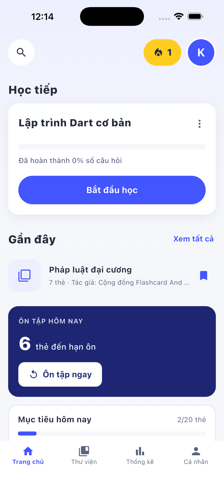
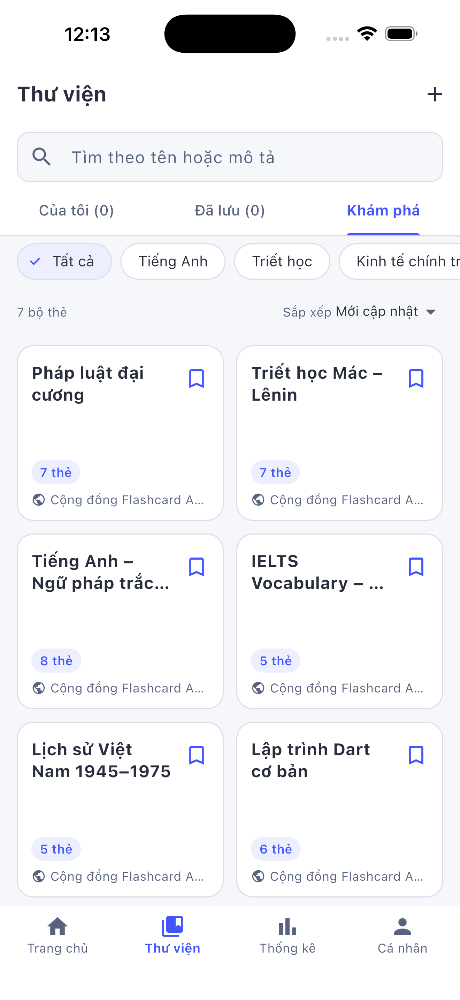
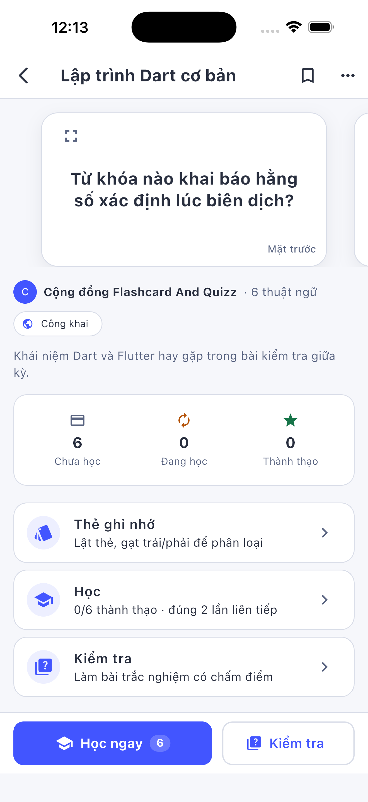
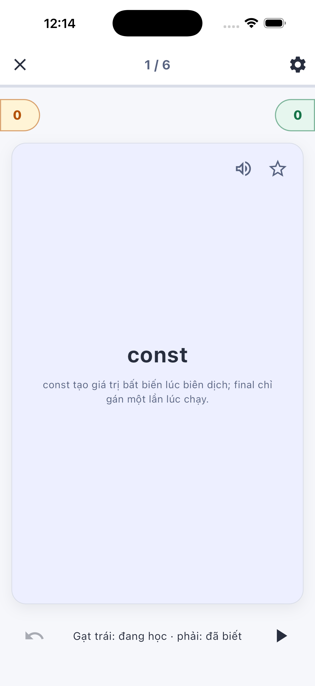
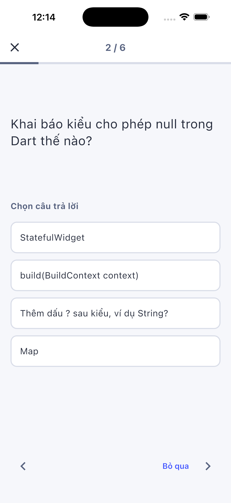
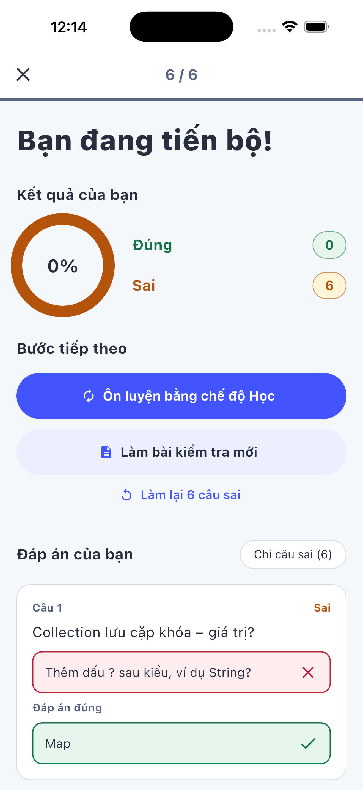
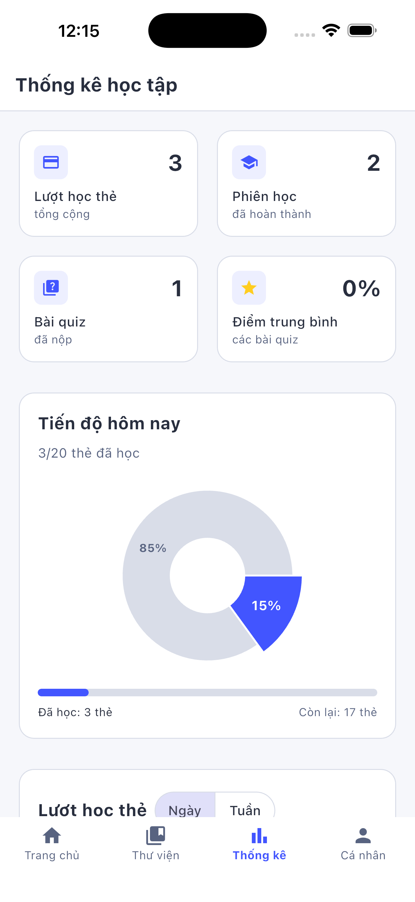
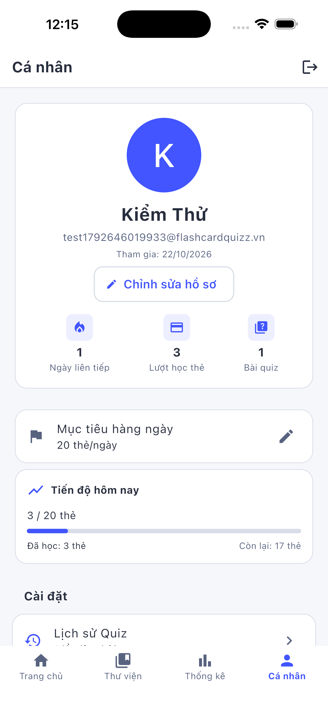

# Flashcard And Quizz – Ứng dụng học tập bằng Flashcard và Quiz

> Bài tập lớn môn **Lập trình cho thiết bị di động** – Trường Đại học Phenikaa (học kỳ 1, 2026–2027)
> Đề tài: **Xây dựng ứng dụng mobile quiz flashcard học tập**

Flashcard And Quizz giúp sinh viên tự tạo bộ thẻ ghi nhớ, học bằng lật thẻ, luyện tập theo lượt, làm bài kiểm tra trắc nghiệm và theo dõi tiến độ học. Dữ liệu được đồng bộ theo tài khoản qua Firebase và vẫn dùng được khi mất mạng.

- Repository: <https://github.com/GianManhDuc-23010464/nhom_duc_thuy_tung_toan>
- Video demo: [link demo]

## Mục lục

1. [Thành viên và phân công](#1-thành-viên-và-phân-công)
2. [Chức năng](#2-chức-năng)
3. [Ảnh màn hình](#3-ảnh-màn-hình)
4. [Công nghệ](#4-công-nghệ)
5. [Kiến trúc và cấu trúc thư mục](#5-kiến-trúc-và-cấu-trúc-thư-mục)
6. [Cơ sở dữ liệu Firestore](#6-cơ-sở-dữ-liệu-firestore)
7. [Cài đặt và chạy](#7-cài-đặt-và-chạy)
8. [Kiểm thử](#8-kiểm-thử)
9. [Quy ước commit](#9-quy-ước-commit)

## 1. Thành viên và phân công

| Họ tên | MSSV | Phụ trách |
|---|---|---|
| Gian Mạnh Đức | 23010464 | Kết nối Firebase, xác thực, lớp dữ liệu (`data_store`, `flashcard_service`), Trang chủ, Thư viện, Chi tiết bộ thẻ |
| Nguyễn Đình Tùng | 24100188 | Lớp chung `BaseEntity`, `FirestoreRepository<T>`, `BaseScaffold`, Thống kê, `ListFlashcardSet`, test Firestore |
| Mai Thị Thủy | 23010362 | Trang cá nhân & cài đặt, sửa hồ sơ, đăng nhập / đăng ký / quên mật khẩu, `ListQuizAttempt` |
|  Vũ Đức Toàn | 24100233 | Học thẻ ghi nhớ, học theo lượt, bài kiểm tra & kết quả, `ListFlashcard`, thư mục `logic/` |

Giảng viên hướng dẫn: Nguyễn Lệ Thu

## 2. Chức năng

**Tài khoản**
- Đăng ký, đăng nhập, đăng xuất bằng email / mật khẩu (Firebase Authentication); tự giữ phiên đăng nhập.
- Quên mật khẩu: gửi email đặt lại mật khẩu.
- Đổi tên hiển thị; tên tác giả trên các bộ thẻ được cập nhật theo.
- Thông báo lỗi bằng tiếng Việt (email đã tồn tại, sai mật khẩu, mất mạng…).

**Trang chủ**
- Học tiếp bộ thẻ gần nhất (hiện % câu hỏi đã hoàn thành), bộ thẻ gần đây, số thẻ đến hạn ôn hôm nay, mục tiêu trong ngày, gợi ý bộ thẻ công khai.

**Bộ thẻ và thẻ**
- Tạo bộ thẻ theo 2 bước (thông tin → thêm thẻ), lưu nháp cho đến khi bấm Hoàn tất.
- Sửa, xóa, sao chép bộ thẻ; đặt chế độ riêng tư hoặc công khai; phân loại theo môn học.
- Thêm / sửa / xóa / sắp xếp thẻ: mặt trước, mặt sau, ghi chú, ảnh, tối đa 3 phương án sai tự nhập.
- Gắn sao thẻ khó để học riêng.
- Màn quản lý (Cá nhân › Cài đặt): danh sách bộ thẻ, thẻ, kết quả kiểm tra với thêm / sửa / xóa có xác nhận.

**Thư viện**
- 3 tab: Của tôi / Đã lưu / Khám phá (bộ thẻ công khai của mọi người dùng).
- Tìm kiếm và lọc theo môn học.

**Học tập**
- Thẻ ghi nhớ: lật thẻ, vuốt trái (Đang học) / vuốt phải (Đã biết), hoàn tác, tự động phát, đảo mặt thẻ, đọc to nội dung (Text-to-Speech); học lại các thẻ Đang học khi hết lượt.
- Học theo lượt: mỗi lượt tối đa 7 thẻ, thẻ cần đúng 2 lần liên tiếp để thành thạo, thẻ sai được hỏi lại trước; tùy chọn câu tự luận, trả lời bằng thuật ngữ, chỉ học thẻ gắn sao.
- Ôn tập ngắt quãng: thẻ đến hạn được xếp lịch ôn theo thuật toán SM-2 rút gọn (Quên / Khó / Được / Dễ).
- Lưu vị trí học dở, thoát ra vẫn học tiếp được.

**Bài kiểm tra**
- Thiết lập: số câu, hiển thị đáp án ngay, chỉ hỏi thẻ gắn sao, trả lời bằng định nghĩa / thuật ngữ / cả hai, chọn dạng câu hỏi.
- 3 dạng câu: trắc nghiệm (tối đa 4 phương án), Đúng / Sai, tự luận.
- Chọn đáp án xong tự chuyển câu; màn cuối để xem lại, chọn lại đáp án rồi nộp bài; lưu nháp bài làm dở; chống nộp hai lần.
- Kết quả: % câu đúng, số câu đúng / sai, xem lại từng câu kèm đáp án đúng và giải thích, lọc câu sai, làm lại các câu sai; câu sai đưa thẻ về trạng thái Đang học.
- Lịch sử các lần làm bài.

**Thống kê và cá nhân**
- Số thẻ theo trạng thái (Chưa học / Đang học / Thành thạo), chuỗi ngày học, mục tiêu thẻ mỗi ngày, biểu đồ hoạt động.
- Giao diện sáng / tối / theo hệ thống.
- Nhắc học hằng ngày bằng thông báo cục bộ vào giờ đã chọn (xin quyền thông báo; hủy khi tắt hoặc đăng xuất).

**Offline**
- Dữ liệu được lưu trong cache của Firestore; thao tác khi mất mạng sẽ tự đồng bộ khi có mạng lại. Kết quả quiz chưa đồng bộ được đánh dấu "chờ đồng bộ".

## 3. Ảnh màn hình

_Chụp lại trên bản hiện tại và đặt vào `docs/screenshots/`._

| Trang chủ | Thư viện | Chi tiết bộ thẻ | Học thẻ |
|---|---|---|---|
|  |  |  |  |

| Bài kiểm tra | Kết quả | Thống kê | Cá nhân |
|---|---|---|---|
|  |  |  |  |

## 4. Công nghệ

| Thành phần | Sử dụng |
|---|---|
| Ngôn ngữ / framework | Dart, Flutter (SDK ≥ 3.9) |
| Xác thực | Firebase Authentication (email / mật khẩu) |
| Cơ sở dữ liệu | Cloud Firestore (có offline persistence) |
| Quản lý trạng thái | Provider (`ChangeNotifier`) |
| Biểu đồ | fl_chart |
| Thông báo | flutter_local_notifications, timezone, flutter_timezone (nhắc học hằng ngày) |
| Khác | image_picker, connectivity_plus, shared_preferences (lưu chế độ giao diện), Text-to-Speech qua MethodChannel native |
| Kiểm thử | flutter_test, integration_test, fake_cloud_firestore, firebase_auth_mocks |

## 5. Kiến trúc và cấu trúc thư mục

```
UI (pages, widgets)
   │  đọc / gọi qua Provider
   ▼
FlashcardService  ── nguồn dữ liệu duy nhất, ghi tuần tự, khôi phục khi ghi lỗi
   │  dùng logic thuần Dart          │  ghi / đọc qua interface
   ▼                                 ▼
logic/ (quiz, học theo lượt,     DataStore
SM-2, thống kê)                    ├─ FirestoreDataStore → FirestoreRepository<T> → Cloud Firestore
                                   └─ LocalDataStore (bộ nhớ, dùng cho test)
```

```
lib/
├── main.dart                  # Khởi tạo Firebase, Provider, luồng đăng nhập, bottom navigation
├── firebase_options.dart      # Sinh bởi flutterfire configure
├── models/                    # BaseEntity, FlashcardSet, Flashcard, CardProgress, Quiz, User, UserData
├── logic/                     # quiz_engine, learn_engine, progress_lifecycle (SM-2), stats_calculator
├── services/                  # auth_service, data_store, firestore_repository, flashcard_service,
│                              # connectivity_service, reminder_service, speech_service, seed_data
├── pages/                     # Các màn hình (+ ListFlashcardSet, ListFlashcard, ListQuizAttempt)
├── widgets/                   # base_scaffold, flip_card, set_card, common…
├── theme/                     # app_theme (màu sáng / tối)
├── utils/                     # date_utils, validators, nav
└── tools/seed.dart            # Đẩy bộ thẻ công khai mẫu lên Firestore (chạy một lần)
test/                          # Unit test và widget test
integration_test/              # Kiểm thử luồng chính trên thiết bị
firestore.rules                # Quy tắc bảo mật Firestore
```

**Lớp dùng chung**
- `BaseEntity`: lớp trừu tượng gồm `id`, `name`, `description`, `createdAt`, `updatedAt`, `toMap()`; `FlashcardSet`, `Flashcard`, `QuizAttempt` kế thừa.
- `FirestoreRepository<T extends BaseEntity>`: CRUD tổng quát `getAll`, `getById`, `add`, `update`, `delete`, `watchAll`.
- `BaseScaffold`: khung màn hình thống nhất AppBar, màu, font cho các trang chính.

## 6. Cơ sở dữ liệu Firestore

```
decks/{deckId}                       # Bộ thẻ: userId, ownerName, title, description, subject,
│                                    #         visibility (private | public), status (draft | ready), createdAt, updatedAt
└── cards/{cardId}                   # Thẻ: term, meaning, note, wrongOptions, imagePath, order, createdAt, updatedAt

users/{uid}                          # Hồ sơ + cài đặt: username, email, createdAt, dailyGoal, remindEnabled,
│                                    #   remindTime, savedDeckIds, starredCardIds, lastDeckId, sessions, activity
├── progress/{cardId}                # Tiến độ thẻ: interval, ease, reps, due, known
├── quizAttempts/{attemptId}         # Kết quả bài kiểm tra: deckId, deckTitle, takenAt, durationSeconds, items
└── state/learn                      # Học dở: positions, learnScores, learnRounds, flashSort, quizDraft
```

Mỗi model có `toFirestore()` / `fromFirestore()`, ngày giờ lưu dạng `Timestamp`. Mỗi thao tác chỉ ghi đúng document liên quan; xóa bộ thẻ dùng batch để xóa cả subcollection `cards`.

**Quy tắc bảo mật** (`firestore.rules`)
- `users/{uid}` và các subcollection: chỉ chính chủ được đọc / ghi.
- `decks/{deckId}` và `cards`: đọc được nếu là chủ hoặc bộ thẻ công khai; chỉ chủ được tạo / sửa / xóa và không được đổi chủ sở hữu.

## 7. Cài đặt và chạy

**Yêu cầu:** Flutter SDK ≥ 3.9, Xcode (iOS) hoặc Android Studio (Android), Node.js để cài Firebase CLI.

```bash
git clone https://github.com/GianManhDuc-23010464/nhom_duc_thuy_tung_toan.git
cd nhom_duc_thuy_tung_toan
flutter pub get
```

**Cấu hình Firebase** (chỉ cần khi dùng project Firebase khác project của nhóm)

```bash
npm install -g firebase-tools
dart pub global activate flutterfire_cli
firebase login
flutterfire configure            # sinh lib/firebase_options.dart, google-services.json, GoogleService-Info.plist
```

Trên Firebase Console:
1. Authentication → Sign-in method → bật **Email/Password**.
2. Firestore Database → tạo database.

**Dữ liệu mẫu và quy tắc bảo mật** (theo đúng thứ tự)

```bash
flutter run -t lib/tools/seed.dart          # 1. Đẩy bộ thẻ công khai mẫu (khi Firestore còn ở chế độ test)
firebase deploy --only firestore:rules      # 2. Bật quy tắc bảo mật
```

**Chạy ứng dụng**

```bash
flutter run
```

## 8. Kiểm thử

```bash
flutter analyze                      # Phân tích tĩnh
flutter test                         # Unit test + widget test (126 test)
flutter test integration_test        # Kiểm thử luồng chính, cần mở simulator / thiết bị
```

| File | Nội dung |
|---|---|
| `logic_test.dart` | Vòng đời tiến độ thẻ, SM-2, tạo câu hỏi quiz, học theo lượt, thống kê |
| `service_test.dart` | Tạo / sửa / xóa bộ thẻ, nộp quiz, khôi phục khi ghi lỗi, tách dữ liệu theo người dùng |
| `auth_service_test.dart` | Đăng ký, trùng email, sai mật khẩu, quên mật khẩu, đổi tên, thông báo lỗi |
| `firestore_repository_test.dart` | CRUD và `watchAll` của `FirestoreRepository<T>` |
| `firestore_model_test.dart` | Chuyển model sang Firestore và đọc lại |
| `firestore_data_store_test.dart` | Ghi / đọc đúng document trên Firestore giả lập |
| `reminder_service_test.dart` | Đặt lịch nhắc học lặp hằng ngày, đổi giờ, hủy |
| `widget_test.dart`, `responsive_test.dart` | Giao diện các màn hình chính, nhiều kích thước màn hình |

## 9. Quy ước commit

- Mỗi thành viên commit phần mình phụ trách bằng tài khoản GitHub của mình.
- Mỗi commit một mục đích, message tiếng Việt theo dạng `loại(phạm vi): mô tả`, ví dụ:
  - `feat(quiz): thêm câu hỏi Đúng/Sai`
  - `fix(stats): sửa số thẻ đến hạn`
  - `test(auth): test đăng nhập sai mật khẩu`
- Loại: `feat` (chức năng), `fix` (sửa lỗi), `refactor`, `test`, `docs`, `chore` (cấu hình, dọn dẹp).
- Chạy `flutter analyze` và `flutter test` trước khi push.